# Street-life reference photographs

Downloaded from Wikimedia Commons on **2026-10-26**: Wikimedia-served JPEG thumbnails, 1280 px wide (no crops or colour edits). The licence on each file page was checked when the file was downloaded. Every file is CC BY, CC BY-SA or CC0/public domain. CC BY-SA adaptations must be shared under the same licence; all licences require attribution. Each photo shows conditions on its date; it does not establish present-day assets or statistics. The research note is [../../street-life.md](../../street-life.md).

## bus-yellow-electric-dlb-2023.jpg

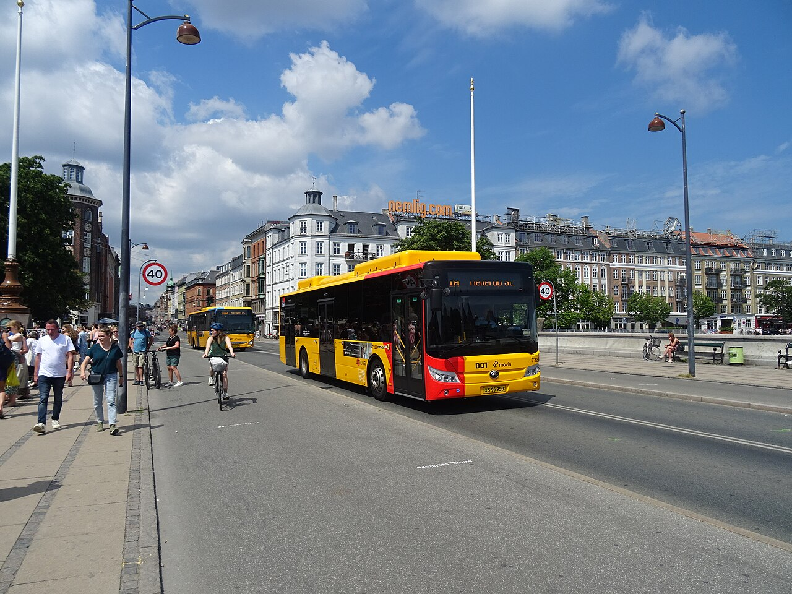

- **Title:** Movia bus line 1A on Dronning Louises Bro.jpg
- **Author:** Leif Jørgensen
- **Date:** 2023-06-25 13:04:58
- **Source:** [https://commons.wikimedia.org/wiki/File:Movia_bus_line_1A_on_Dronning_Louises_Bro.jpg](https://commons.wikimedia.org/wiki/File:Movia_bus_line_1A_on_Dronning_Louises_Bro.jpg)
- **Licence:** [CC BY-SA 4.0](https://creativecommons.org/licenses/by-sa/4.0/)
- **Modification:** Wikimedia thumbnail at 1280 px, renamed
- **Reference use:** Current Movia livery on the bridge: all-yellow 12 m-class electric bus, black glazing band, red A-bus front-right corner, amber LED destination sign. Summer pedestrian clothing, C 55 "40" signs, bench and bin on the bridge.

## dlb-cyclists-2012.jpg

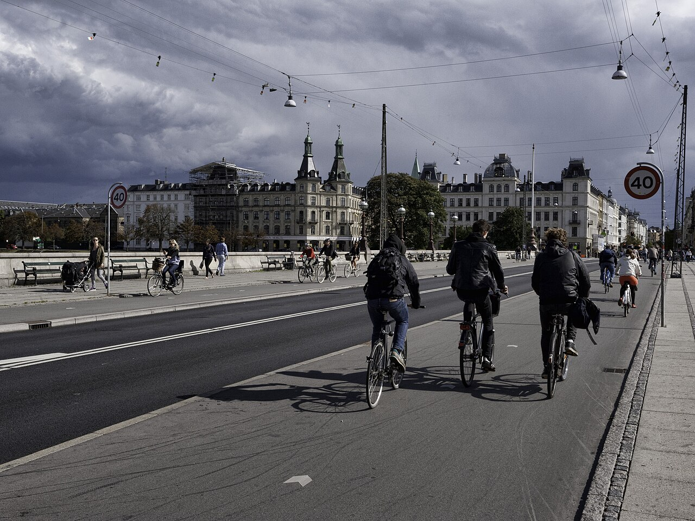

- **Title:** Dronning Louises Bro 2012.jpg
- **Author:** heb@Wikimedia Commons (mail)
- **Date:** 2013-03-24 (Commons date field; description says "summer 2012")
- **Source:** [https://commons.wikimedia.org/wiki/File:Dronning_Louises_Bro_2012.jpg](https://commons.wikimedia.org/wiki/File:Dronning_Louises_Bro_2012.jpg)
- **Licence:** [CC BY-SA 3.0](https://creativecommons.org/licenses/by-sa/3.0/)
- **Modification:** Wikimedia thumbnail at 1280 px, renamed
- **Reference use:** Upright riders in everyday dark clothing, few helmets, the widened cycle track, granite kerb, catenary lamps, benches and people on the bridge's north side.

## dlb-cycle-counter-2011.jpg

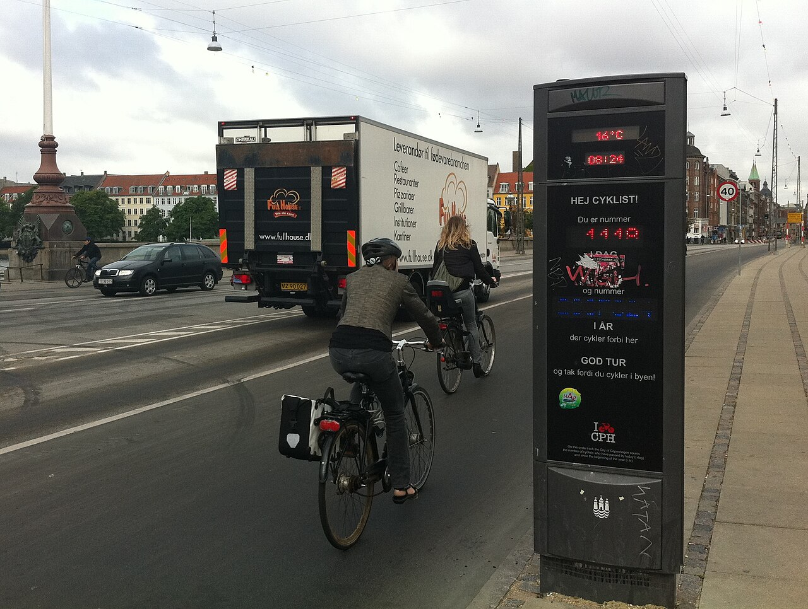

- **Title:** BikecounterCPH.jpg
- **Author:** Thorseth
- **Date:** 2011-07-01
- **Source:** [https://commons.wikimedia.org/wiki/File:BikecounterCPH.jpg](https://commons.wikimedia.org/wiki/File:BikecounterCPH.jpg)
- **Licence:** [CC BY-SA 3.0](https://creativecommons.org/licenses/by-sa/3.0/)
- **Modification:** Wikimedia thumbnail at 1280 px, renamed
- **Reference use:** Bike counter column on Dronning Louises Bro (LED digits, I ♥ CPH logo, stickers); yellow commercial plate on a delivery lorry; cyclists with panniers.

## bus-5c-articulated-2025.jpg

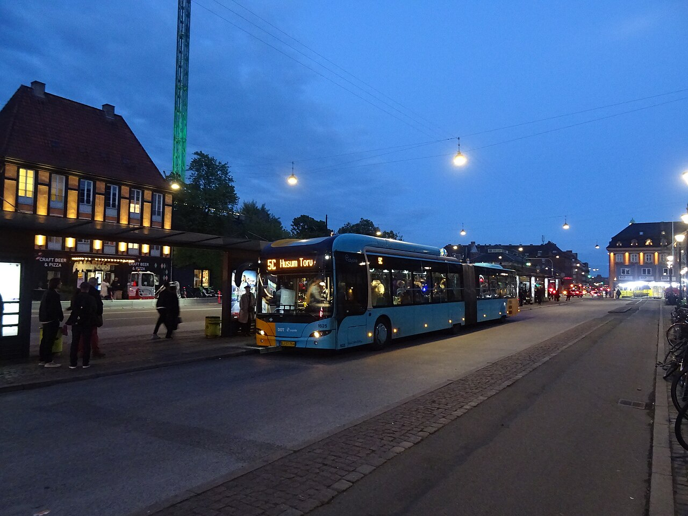

- **Title:** Movia bus line 5C at Hovedbanegården.jpg
- **Author:** Leif Jørgensen
- **Date:** 2025-05-21 22:00:44
- **Source:** [https://commons.wikimedia.org/wiki/File:Movia_bus_line_5C_at_Hovedbaneg%C3%A5rden.jpg](https://commons.wikimedia.org/wiki/File:Movia_bus_line_5C_at_Hovedbaneg%C3%A5rden.jpg)
- **Licence:** [CC BY-SA 4.0](https://creativecommons.org/licenses/by-sa/4.0/)
- **Modification:** Wikimedia thumbnail at 1280 px, renamed
- **Reference use:** Pre-electric 5C: light-blue 18 m articulated bus (May 2025). Use only for scenes dated before April 2026.

## bus-lane-norrebrogade-2019.jpg

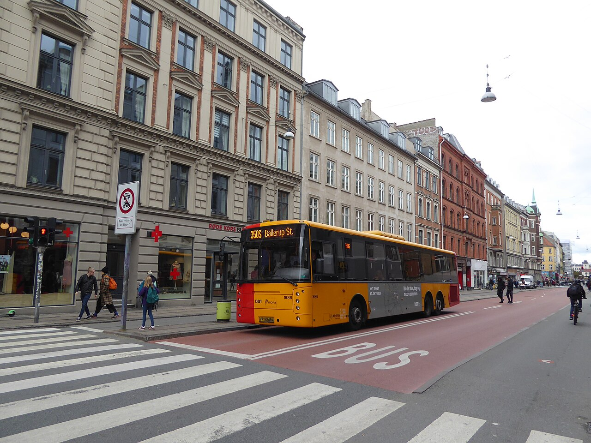

- **Title:** Movia bus line 350S on Nørrebrogade 03.jpg
- **Author:** Leif Jørgensen
- **Date:** 2019-10-03 15:02:47
- **Source:** [https://commons.wikimedia.org/wiki/File:Movia_bus_line_350S_on_N%C3%B8rrebrogade_03.jpg](https://commons.wikimedia.org/wiki/File:Movia_bus_line_350S_on_N%C3%B8rrebrogade_03.jpg)
- **Licence:** [CC BY-SA 4.0](https://creativecommons.org/licenses/by-sa/4.0/)
- **Modification:** Wikimedia thumbnail at 1280 px, renamed
- **Reference use:** Red-asphalt bus lane with white BUS lettering on Nørrebrogade; yellow 3-axle 13.7 m-class bus; zebra crossing; type C sign on a grey pole; façade signal head.

## plate-private-2025.jpg

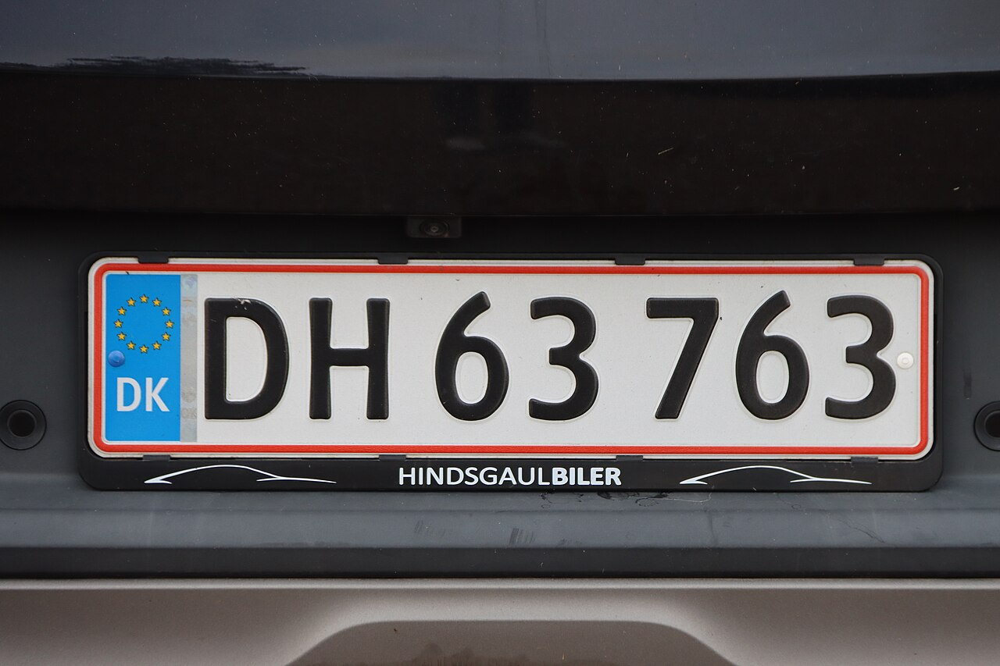

- **Title:** Danish license plate.jpg
- **Author:** FrDr
- **Date:** 2025-09-20 18:22:47
- **Source:** [https://commons.wikimedia.org/wiki/File:Danish_license_plate.jpg](https://commons.wikimedia.org/wiki/File:Danish_license_plate.jpg)
- **Licence:** [CC BY-SA 4.0](https://creativecommons.org/licenses/by-sa/4.0/)
- **Modification:** Wikimedia thumbnail at 1280 px, renamed
- **Reference use:** Private plate: white, thin red border, blue EU/DK band, black condensed characters, AB 12 345 layout.

## plate-commercial-yellow.jpg

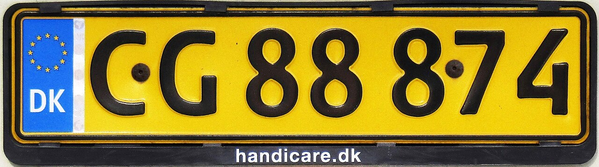

- **Title:** Danish commercial license plate.jpg
- **Author:** Walser123
- **Date:** 2020-06-04 04:30:39
- **Source:** [https://commons.wikimedia.org/wiki/File:Danish_commercial_license_plate.jpg](https://commons.wikimedia.org/wiki/File:Danish_commercial_license_plate.jpg)
- **Licence:** [CC BY-SA 4.0](https://creativecommons.org/licenses/by-sa/4.0/)
- **Modification:** Wikimedia thumbnail at 1280 px, renamed
- **Reference use:** Commercial (van) plate: same layout on yellow.

## police-van-2016.jpg

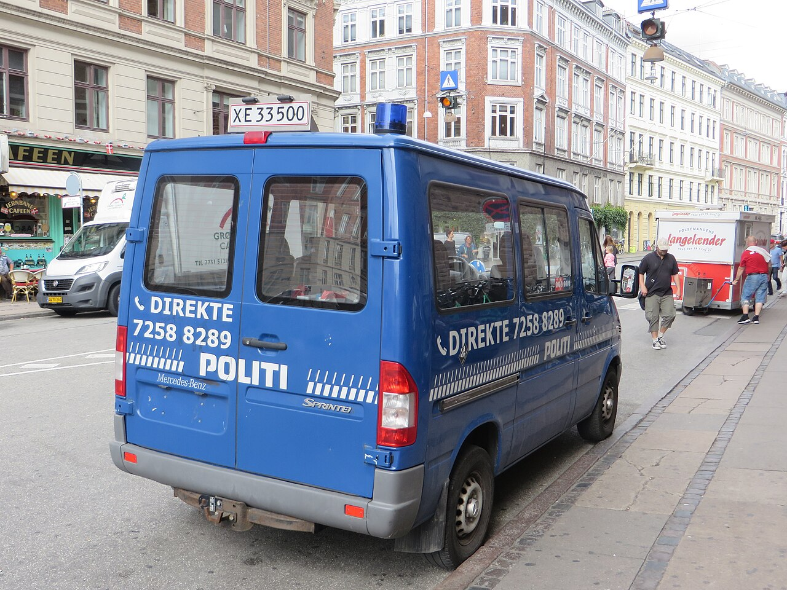

- **Title:** Police car in Copenhagen Denmark 01.jpg
- **Author:** Dickelbers
- **Date:** 2016-08-05 10:05:13
- **Source:** [https://commons.wikimedia.org/wiki/File:Police_car_in_Copenhagen_Denmark_01.jpg](https://commons.wikimedia.org/wiki/File:Police_car_in_Copenhagen_Denmark_01.jpg)
- **Licence:** [CC BY-SA 4.0](https://creativecommons.org/licenses/by-sa/4.0/)
- **Modification:** Wikimedia thumbnail at 1280 px, renamed
- **Reference use:** Blue POLITI Sprinter van with chequered band and roof beacon; also café seating and a European van on a Copenhagen street. A rare-vehicle reference only.

## glass-igloo-2014.jpg

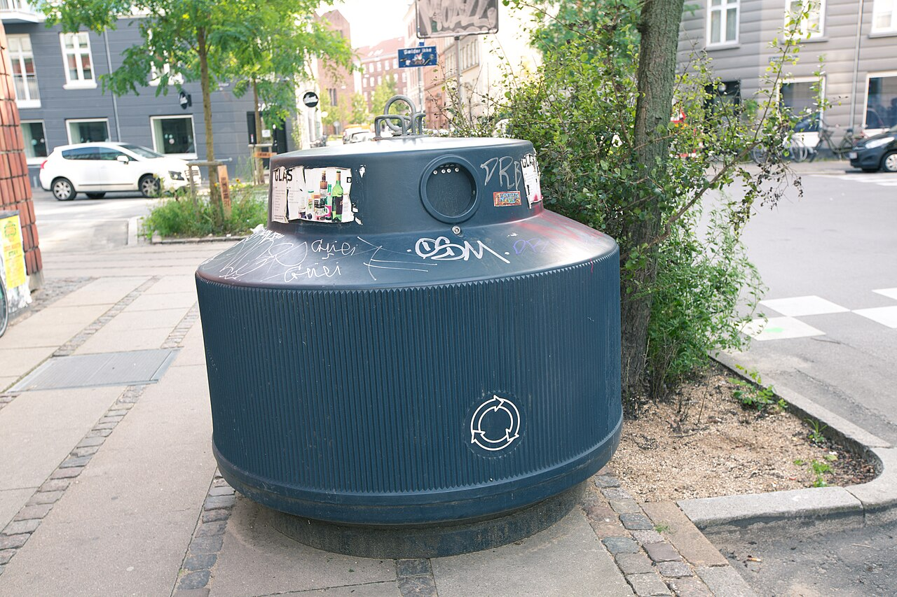

- **Title:** Copenhagen Recycling Bin 6D2B7596.jpg
- **Author:** Tony Webster
- **Date:** 2014-09-15
- **Source:** [https://commons.wikimedia.org/wiki/File:Copenhagen_Recycling_Bin_6D2B7596.jpg](https://commons.wikimedia.org/wiki/File:Copenhagen_Recycling_Bin_6D2B7596.jpg)
- **Licence:** [CC BY-SA 3.0](https://creativecommons.org/licenses/by-sa/3.0/)
- **Modification:** Wikimedia thumbnail at 1280 px, renamed
- **Reference use:** Dark slate ribbed glass-recycling igloo with stickers on a Københavnerfortov corner; granite kerb and tree pit.

## ravnsborggade-parked-2017.jpg

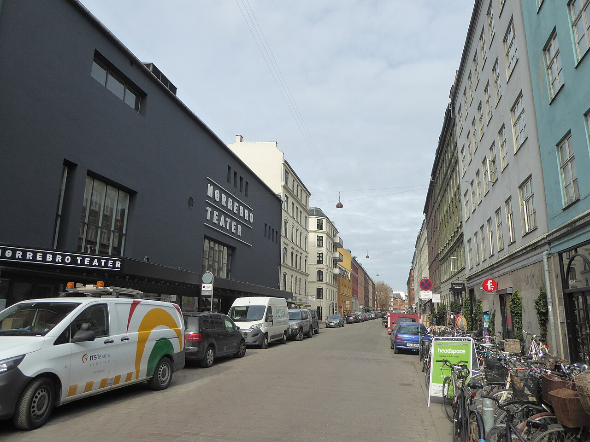

- **Title:** Ravnsborggade 02.jpg
- **Author:** Leif Jørgensen
- **Date:** 2017-03-16 14:21:59
- **Source:** [https://commons.wikimedia.org/wiki/File:Ravnsborggade_02.jpg](https://commons.wikimedia.org/wiki/File:Ravnsborggade_02.jpg)
- **Licence:** [CC BY-SA 4.0](https://creativecommons.org/licenses/by-sa/4.0/)
- **Modification:** Wikimedia thumbnail at 1280 px, renamed
- **Reference use:** Nørrebro side street: dense parked bikes with baskets along the façade, modern European cars and white vans on the kerb, sandwich board, catenary lamps.

## blagardsgade-cafe-2014.jpg

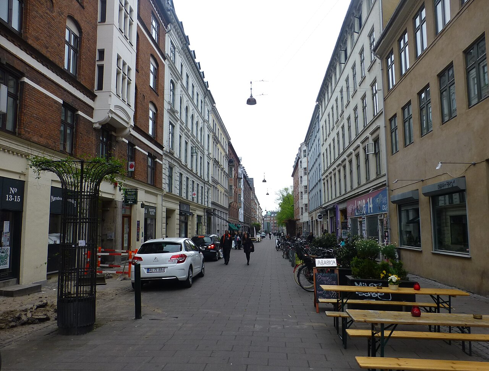

- **Title:** Blågårdsgade 2.jpg
- **Author:** Leif Jørgensen
- **Date:** 2014-05-06 14:25:55
- **Source:** [https://commons.wikimedia.org/wiki/File:Bl%C3%A5g%C3%A5rdsgade_2.jpg](https://commons.wikimedia.org/wiki/File:Bl%C3%A5g%C3%A5rdsgade_2.jpg)
- **Licence:** [CC BY-SA 3.0](https://creativecommons.org/licenses/by-sa/3.0/)
- **Modification:** Wikimedia thumbnail at 1280 px, renamed
- **Reference use:** Café spill-out on a Nørrebro pedestrian street: beer-garden benches and tables, chalk sandwich board, planters, parked bikes, small hatchback.

## norrebrogade-corner-bikes-2019.jpg

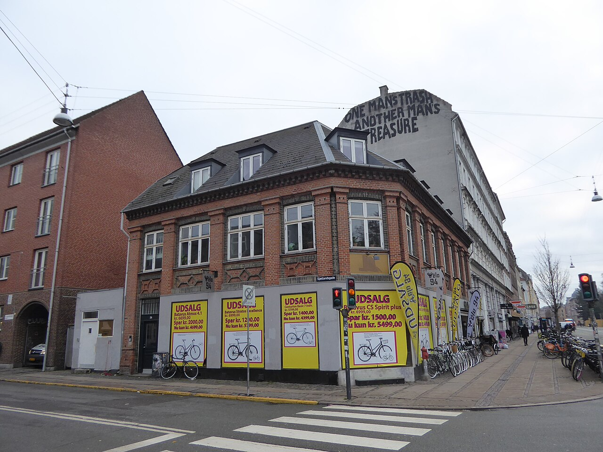

- **Title:** Vélo 94.jpg
- **Author:** Leif Jørgensen
- **Date:** 2019-01-28 13:48:21
- **Source:** [https://commons.wikimedia.org/wiki/File:V%C3%A9lo_94.jpg](https://commons.wikimedia.org/wiki/File:V%C3%A9lo_94.jpg)
- **Licence:** [CC BY-SA 4.0](https://creativecommons.org/licenses/by-sa/4.0/)
- **Modification:** Wikimedia thumbnail at 1280 px, renamed
- **Reference use:** Nørrebrogade/Sjællandsgade corner: rows of parked city bikes, yellow T 61 kerb line, signal heads, zebra crossing.

## cargo-bike-norrebrogade-2013.jpg

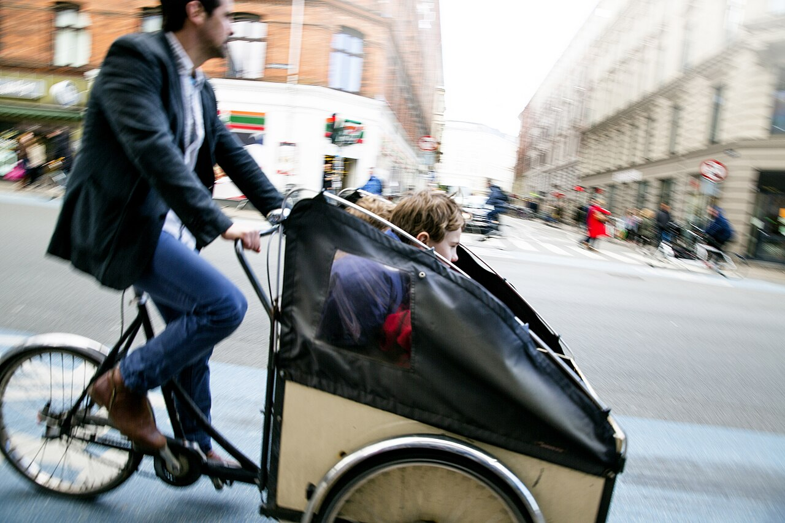

- **Title:** Cargo bike Copenhagen 20130420 01F (8724864047).jpg
- **Author:** News Oresund
- **Date:** Taken on 20 April 2013, 15:29:15 (according to Exif data)
- **Source:** [https://commons.wikimedia.org/wiki/File:Cargo_bike_Copenhagen_20130420_01F_(8724864047).jpg](https://commons.wikimedia.org/wiki/File:Cargo_bike_Copenhagen_20130420_01F_(8724864047).jpg)
- **Licence:** [CC BY 2.0](https://creativecommons.org/licenses/by/2.0/)
- **Modification:** Wikimedia thumbnail at 1280 px, renamed
- **Reference use:** Christiania-type three-wheel cargo bike with plywood box, black canopy and child, ridden upright in everyday clothes on Nørrebrogade.

## norre-sogade-autumn-2015.jpg

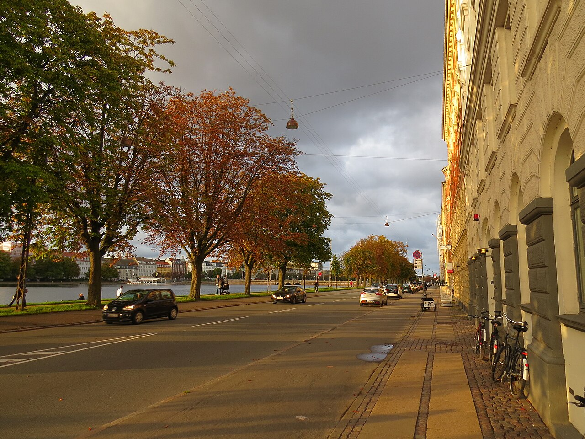

- **Title:** Nørre Søgade ved Søerne.jpg
- **Author:** Orf3us
- **Date:** 2015-09
- **Source:** [https://commons.wikimedia.org/wiki/File:N%C3%B8rre_S%C3%B8gade_ved_S%C3%B8erne.jpg](https://commons.wikimedia.org/wiki/File:N%C3%B8rre_S%C3%B8gade_ved_S%C3%B8erne.jpg)
- **Licence:** [CC BY 3.0](https://creativecommons.org/licenses/by/3.0/)
- **Modification:** Wikimedia thumbnail at 1280 px, renamed
- **Reference use:** Nørre Søgade by Peblinge Sø: small European cars, bikes on kickstands against the façade, slab-and-sett pavement, catenary lamp, autumn chestnuts.
