# Licensed reference photographs

Downloaded and file-page licences checked on **2026-10-25**. Twelve Wikimedia-served JPEG thumbnails, nominally 960 pixels wide; portrait images are taller. No crops or colour edits were made. These are dated visual references, not proof of present-day asset placement.

Each attribution below identifies the original file title, author, source and licence. Retain that information when redistributing these images. CC BY-SA adaptations require the corresponding share-alike terms; CC BY requires attribution. These licences apply to the photographs, not automatically to municipal/manufacturer images linked from the guide. Full metadata and download URLs are in [images.json](images.json).

## bridge-lamp.jpg

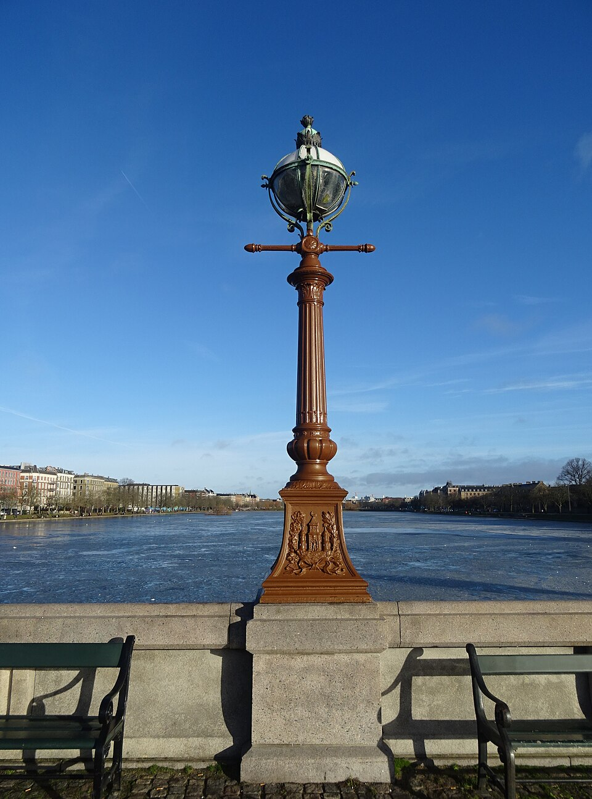

**Gadelampe på Dronning Louises Bro 01.jpg** — Leif Jørgensen. Date: 14 January 2024, 11:48:06. [Original file page](https://commons.wikimedia.org/wiki/File:Gadelampe_p%C3%A5_Dronning_Louises_Bro_01.jpg); [CC BY-SA 4.0](https://creativecommons.org/licenses/by-sa/4.0). Modification: Wikimedia thumbnail only.

Reference use: Heritage lamp, brown shaft, patinated globe cage, green benches and stone parapet.

## bridge-corner.jpg

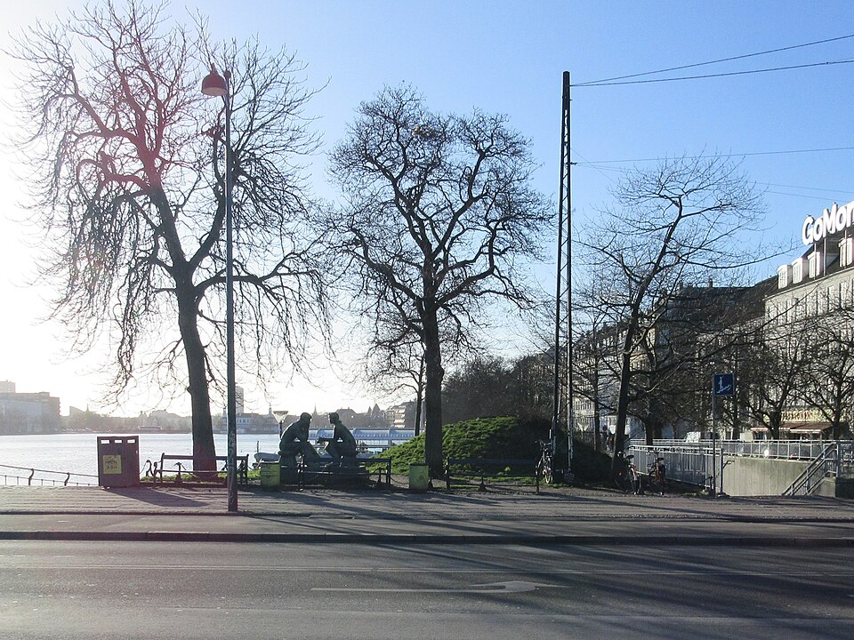

**Dronning Louises Bro - corner 01.jpg** — Ramblersen2. Date: Taken on 21 January 2020, 12:21:12. [Original file page](https://commons.wikimedia.org/wiki/File:Dronning_Louises_Bro_-_corner_01.jpg); [CC BY-SA 4.0](https://creativecommons.org/licenses/by-sa/4.0). Modification: Wikimedia thumbnail only.

Reference use: Lattice masts, overhead lamp, winter branching, curved bench/chain details; 2020 conditions.

## bridge-overview.jpg

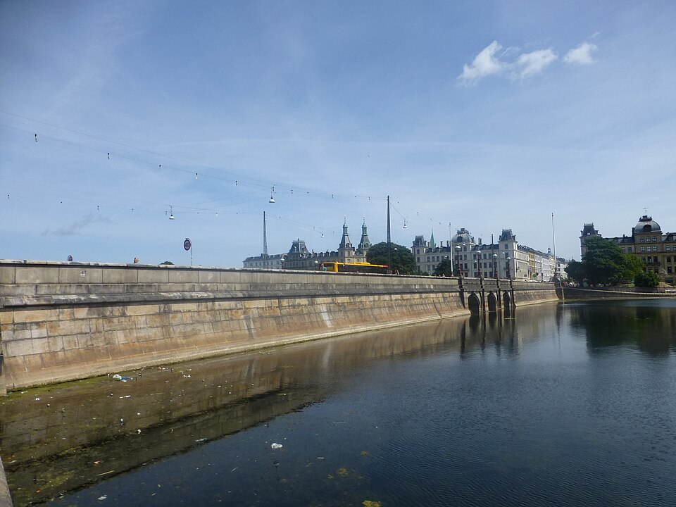

**Dronning Louises Bro 01.JPG** — Leif Jørgensen. Date: 19 July 2013, 14:27:12. [Original file page](https://commons.wikimedia.org/wiki/File:Dronning_Louises_Bro_01.JPG); [CC BY-SA 3.0](https://creativecommons.org/licenses/by-sa/3.0). Modification: Wikimedia thumbnail only.

Reference use: Three arches, masonry courses, waterline staining, parapet and separate roadway catenary.

## bridge-sotorvet.jpg

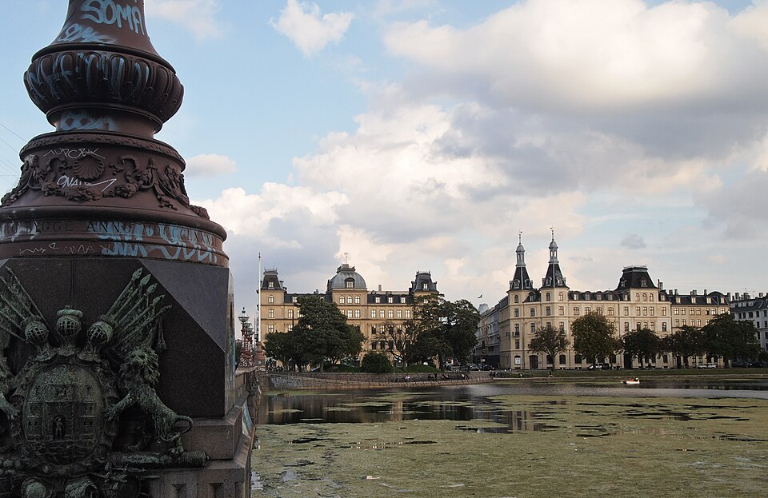

**Dronning Louises Bro.jpg** — Grisha Levit from Brooklyn, USA. Date: 20 August 2011, 12:42. [Original file page](https://commons.wikimedia.org/wiki/File:Dronning_Louises_Bro.jpg); [CC BY-SA 2.0](https://creativecommons.org/licenses/by-sa/2.0). Modification: Wikimedia thumbnail only.

Reference use: Decorative end pedestal/bronze arms and monumental Søtorvet massing; do not use the filename as precise object identification.

## bridge-cycles.jpg

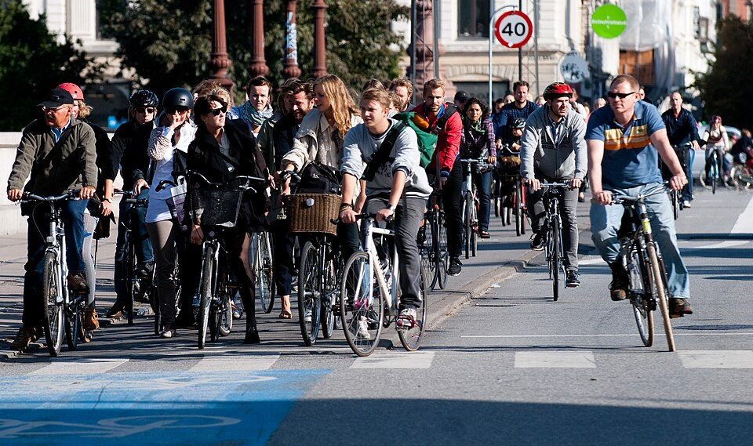

**Cyclists at red 2.jpg** — heb @ Wikimedia Commons ( mail ). Date: 2010. [Original file page](https://commons.wikimedia.org/wiki/File:Cyclists_at_red_2.jpg); [CC BY-SA 3.0](https://creativecommons.org/licenses/by-sa/3.0). Modification: Wikimedia thumbnail only.

Reference use: City-bike frame/accessory mix, crossing surface and kerb; moving bicycles, not a measured parking census.

## peblinge-path.jpg

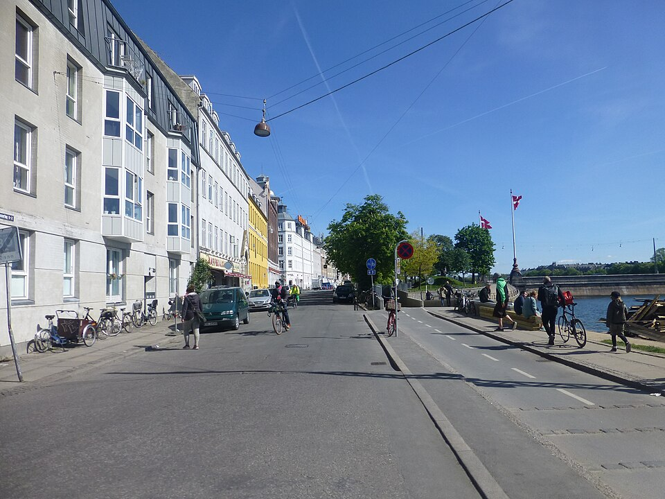

**Peblinge Dossering 01.JPG** — Leif Jørgensen. Date: 1 May 2014, 10:55:35. [Original file page](https://commons.wikimedia.org/wiki/File:Peblinge_Dossering_01.JPG); [CC BY-SA 3.0](https://creativecommons.org/licenses/by-sa/3.0). Modification: Wikimedia thumbnail only.

Reference use: Upper street/cycle route, overhead bell lamp, parked cargo bike, signs and façades; not a close-up of lower gravel path.

## peblinge-facades.jpg

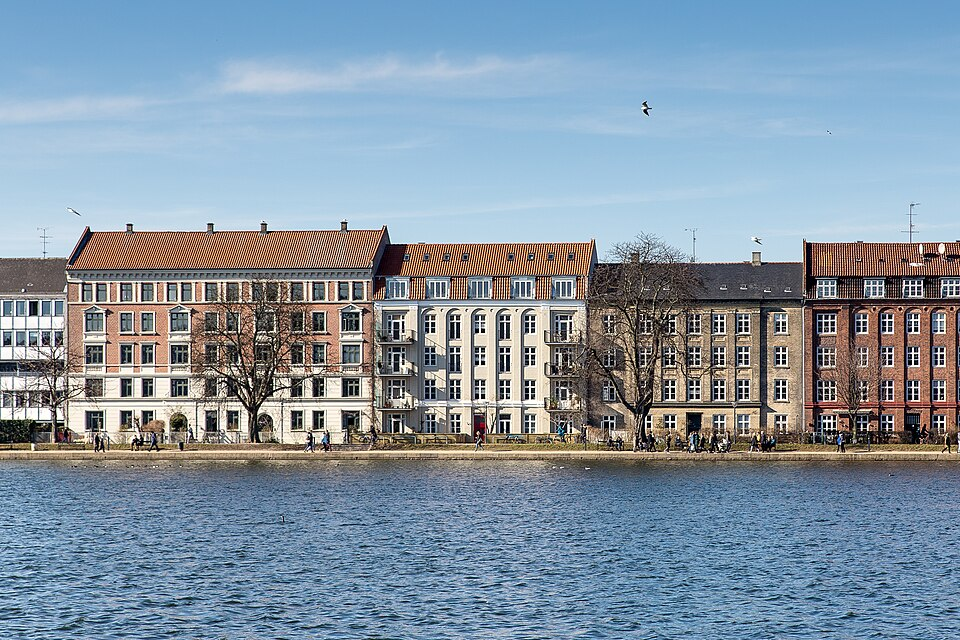

**Peblinge Dossering facades.jpg** — Chris from Berlin, Deutschland. Date: 8 March 2015, 13:52. [Original file page](https://commons.wikimedia.org/wiki/File:Peblinge_Dossering_facades.jpg); [CC BY 2.0](https://creativecommons.org/licenses/by/2.0). Modification: Wikimedia thumbnail only.

Reference use: Yellow/red brick, pale render, roof variation and open lake edge.

## norre-sogade-01.jpg

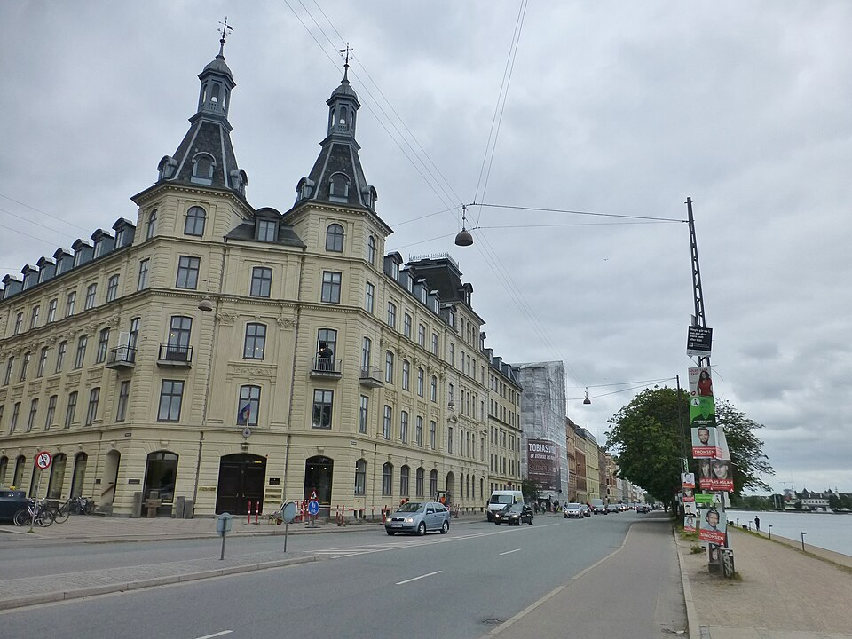

**Nørre Søgade 01.JPG** — Leif Jørgensen. Date: 16 June 2015. [Original file page](https://commons.wikimedia.org/wiki/File:N%C3%B8rre_S%C3%B8gade_01.JPG); [CC BY-SA 4.0](https://creativecommons.org/licenses/by-sa/4.0). Modification: Wikimedia thumbnail only.

Reference use: Søtorvet massing, lattice support, suspended lamps, lower path and low path lights; wide-angle distortion.

## norre-sogade-02.jpg

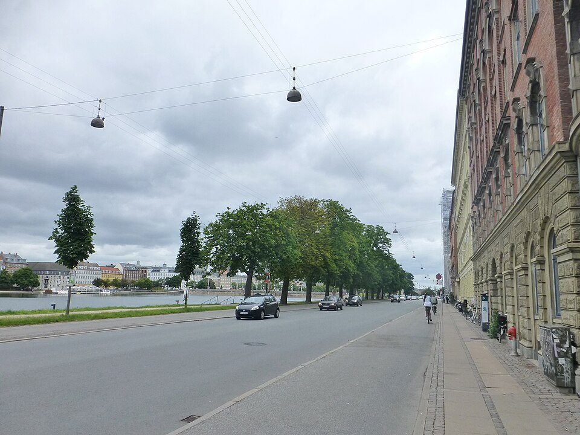

**Nørre Søgade 02.JPG** — Leif Jørgensen. Date: 16 June 2015. [Original file page](https://commons.wikimedia.org/wiki/File:N%C3%B8rre_S%C3%B8gade_02.JPG); [CC BY-SA 4.0](https://creativecommons.org/licenses/by-sa/4.0). Modification: Wikimedia thumbnail only.

Reference use: Double suspended lamps, tree row, two-level cycle kerbs and slab/cobble footway.

## norre-sogade-03.jpg

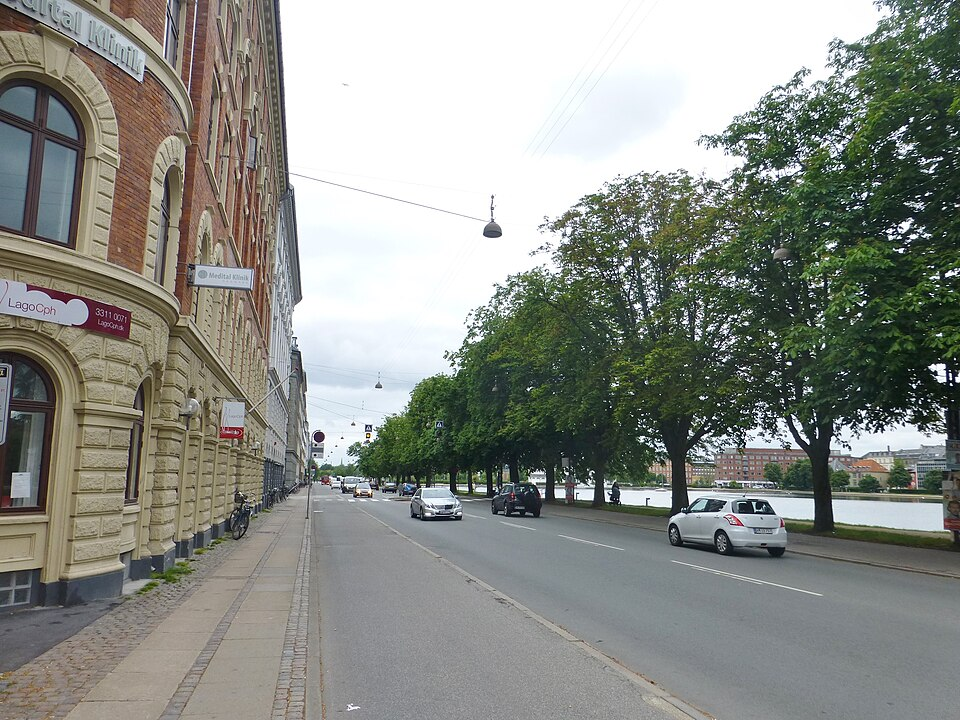

**Nørre Søgade 03.JPG** — Leif Jørgensen. Date: 16 June 2015. [Original file page](https://commons.wikimedia.org/wiki/File:N%C3%B8rre_S%C3%B8gade_03.JPG); [CC BY-SA 4.0](https://creativecommons.org/licenses/by-sa/4.0). Modification: Wikimedia thumbnail only.

Reference use: Street section in opposite direction, mature tree crowns, pale rustication and overhead lamps.

## norre-sogade-25.jpg

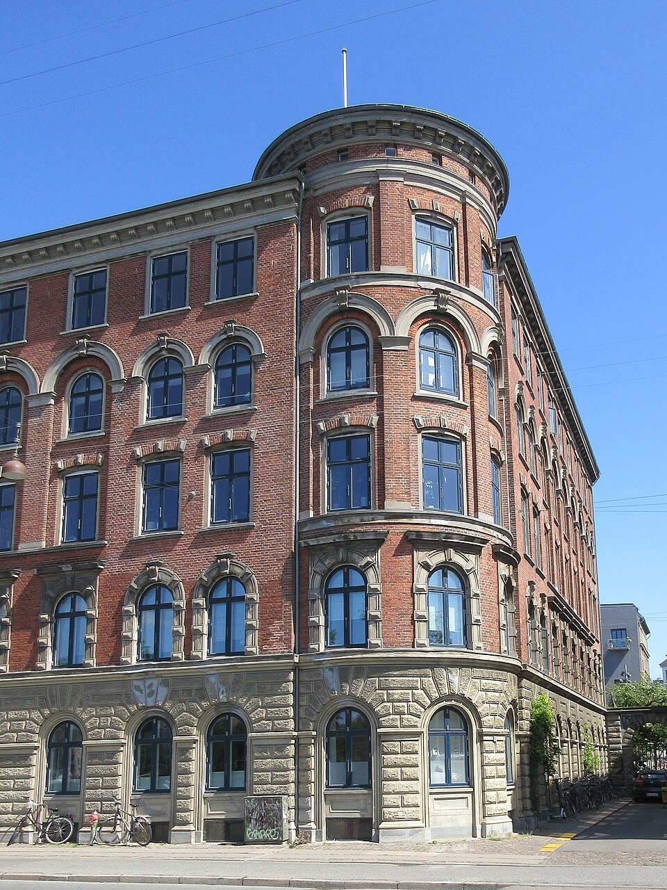

**Nørre Søgade 25.jpg** — Ramblersen2. Date: 26 June 2019, 13:59:09. [Original file page](https://commons.wikimedia.org/wiki/File:N%C3%B8rre_S%C3%B8gade_25.jpg); [CC BY-SA 4.0](https://creativecommons.org/licenses/by-sa/4.0). Modification: Wikimedia thumbnail only.

Reference use: Red-brick corner façade, pale ornament, dark frames, gateway and wall-mounted lamp.

## building-threshold.jpg

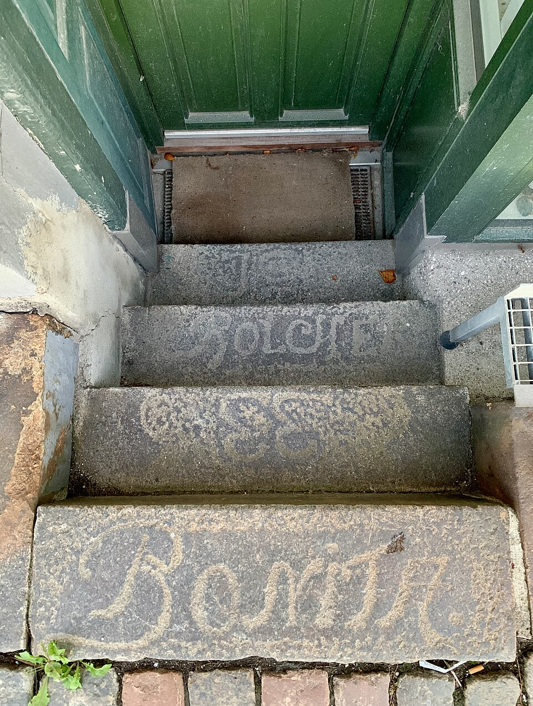

**Stentrappe i Nørre Søgade.jpg** — Orf3us. Date: 2026. [Original file page](https://commons.wikimedia.org/wiki/File:Stentrappe_i_N%C3%B8rre_S%C3%B8gade.jpg); [CC BY-SA 4.0](https://creativecommons.org/licenses/by-sa/4.0). Modification: Wikimedia thumbnail only.

Reference use: Worn granite entrance steps, green painted joinery and metal grating; building threshold, NOT a lake access stair.

